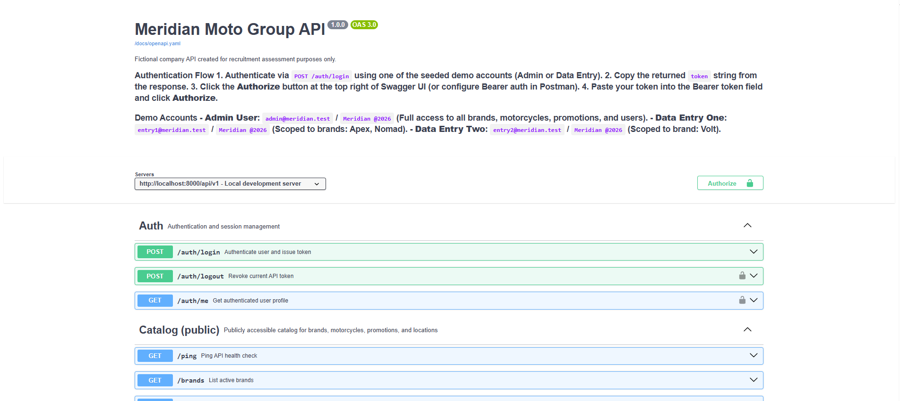
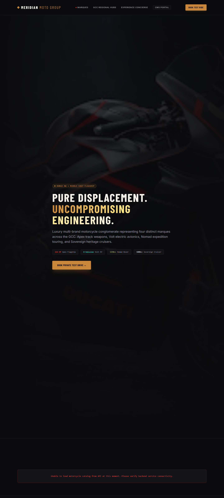
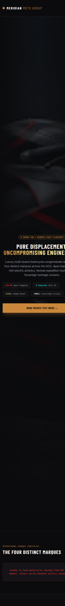

# Meridian Moto Group

> **Fictional Company Notice:** Meridian Moto Group is a fictional company created solely for recruitment assessment and demonstration purposes. All brand names, logos, trademarks, and imagery (Volt, Nomad, Apex, Sovereign) remain the property of their respective owners and are used purely for illustrative context in this engineering evaluation.

---

## Overview

Meridian Moto Group is an enterprise-grade web application and REST API platform for an exclusive high-performance motorcycle manufacturer featuring four distinct marques: **Volt** (Electric Performance), **Nomad** (Adventure & Touring), **Apex** (Track & Hyper-Sport), and **Sovereign** (Ultra-Luxury Cruisers). 

The platform consists of:
- **Backend API (`/backend`)**: Robust Laravel REST API featuring strict form request validation, service-layer business logic, repository pattern abstraction, Eloquent policies, API Resources, Sanctum authentication, Spatie permissions, and comprehensive automated test suites (Pest / PHPUnit).
- **Frontend App (`/frontend`)**: Modern Next.js (App Router, TypeScript, Tailwind CSS) web application delivering an immersive public showroom, interactive test ride booking, regional dealer hubs map (Leaflet), and a fully secured Content Management System (CMS) admin portal.

---

## Architecture

```mermaid
graph TD
    Client[Next.js Client / Browser] -->|HTTP / HTTPS| Frontend[Next.js App Router Server]
    Frontend -->|Internal API Route Handlers / Cookies| Backend[Laravel REST API /api/v1]
    Backend -->|Eloquent ORM & Policies| MySQL[(MySQL 8.4 Database)]
    Backend -->|Swagger UI / OpenAPI Spec| Docs[/docs & /docs/openapi.yaml]
    PhpMyAdmin[phpMyAdmin] -->|DB Management| MySQL
```

---

## Technology Choices & Rationale

- **Laravel & PHP 8.3/8.5**: Industry-standard robust backend framework providing elegant ORM, robust policy authorization, seamless request validation, and comprehensive testing capabilities.
- **Next.js (App Router)**: Cutting-edge React framework enabling Server-Side Rendering (SSR), server actions, high-performance static optimization, and secure cookie-based session token handling.
- **MySQL 8.4 & phpMyAdmin**: Production-ready relational database with strict constraints, indexing, and visual database management.
- **Tailwind CSS & Vanilla CSS**: High-performance utility-first styling combined with custom design tokens for rich aesthetics and responsive layouts.
- **Docker Compose**: Containerized multi-service architecture ensuring identical behavior across development and production environments.

---

## How to Run (Step-by-Step)

### 1. Prerequisites
- **Docker Desktop** (with Compose v2 enabled)
- **Git**
- *Optional (for running tests/dev outside Docker)*: Node.js LTS (v22+ matching frontend/Dockerfile), PHP 8.3+, Composer, and MySQL 8.4.

### 2. Quick Start with Docker (One Command)
Clone the repository and start the entire containerized stack from the root directory:

#### PowerShell (Windows)
```powershell
git clone https://github.com/mohamedabdelazizahmed/meridian-moto-group.git
cd meridian-moto-group
docker compose up -d --build
```

#### Bash (Linux / macOS)
```bash
git clone https://github.com/mohamedabdelazizahmed/meridian-moto-group.git
cd meridian-moto-group
docker compose up -d --build
```

*Note:* Copying `.env.example` to `.env` in root is optional as production defaults are pre-configured in `docker-compose.yml`. The first build takes a few minutes while Docker downloads base images and compiles frontend and backend dependencies.

Verify running containers:
```bash
docker compose ps
```
A healthy output shows `mysql`, `backend`, `frontend`, and `phpmyadmin` running with health checks passing.

#### Service Access & URLs
| Service | URL | Default Credentials / Notes |
| :--- | :--- | :--- |
| **Public Showroom** | `http://localhost:3000` | Immersive frontend catalog & test ride booking |
| **CMS Admin Login** | `http://localhost:3000/cms/login` | Secure management dashboard |
| **Laravel REST API** | `http://localhost:8000/api/v1` | JSON API endpoints |
| **Swagger UI (API Docs)** | `http://localhost:8000/docs` | Interactive API documentation |
| **phpMyAdmin** | `http://localhost:8080` | User: `meridian`, Password: `secret` |

#### Demo Accounts & Permissions
| Role | Email | Password | Access Scope |
| :--- | :--- | :--- | :--- |
| **Administrator** | `admin@meridian.test` | `Meridian @2026` | Full access across all 4 brands, models, promotions, and user management. |
| **Data Entry (Volt/Nomad)** | `entry1@meridian.test` | `Meridian @2026` | Restricted to assigned brands (Volt, Nomad) for models and promotions. |
| **Data Entry (Apex)** | `entry2@meridian.test` | `Meridian @2026` | Restricted to assigned brands (Apex) for models and promotions. |

*Warning:* Ports `3000`, `8000`, `8080`, and `3307` must be free on your host machine. To change ports, modify `WEB_PORT`, `APP_PORT`, `PMA_PORT`, or `DB_FORWARD_PORT` in your root `.env` or run with environment variables (e.g., `$env:WEB_PORT="3100"; docker compose up -d`). Ensure any other local dev stacks are stopped first.

---

## Database, Migrations & Seeders

Migrations and database seeding run automatically upon container startup via `backend/docker/entrypoint.sh`. The seeder populates:
- Spatie roles (`admin`, `data_entry`) and permissions.
- 4 manufacturer brands (**Volt**, **Nomad**, **Apex**, **Sovereign**).
- 6 motorcycle models with specs, pricing, and sample imagery.
- 5 active promotional campaigns.
- 4 regional dealership locations.
- 3 pre-configured demo users with role and brand assignments.

#### Manual Database Commands
- **Run migrations**: `docker compose exec backend php artisan migrate --force`
- **Seed database**: `docker compose exec backend php artisan db:seed --force`
- **Full reset & reseed**: `docker compose exec backend php artisan migrate:fresh --seed --force`
- **Wipe database & volumes**: `docker compose down -v`

---

## Running the Tests

#### Backend Tests (Pest / PHPUnit)
```bash
docker compose exec backend php artisan test
```
*(Note: Tests utilize the `testing` database configured in `backend/phpunit.xml` and isolated database transactions.)*

#### Code Style (Laravel Pint)
```bash
docker compose exec backend ./vendor/bin/pint --test
```

#### Frontend Tests (Vitest & TypeScript)
```bash
cd frontend
npm ci
npm run lint
npx tsc --noEmit
npx vitest run
```
*Note:* Test suites include OpenAPI route-coverage assertions and controller query-count performance checks.

---

## Useful Docker Commands

- **View backend logs**: `docker compose logs --tail 100 backend`
- **Rebuild a single service**: `docker compose build --no-cache frontend`
- **Open a shell inside backend**: `docker compose exec backend bash`
- **List API routes**: `docker compose exec backend php artisan route:list --path=api/v1`

---

## Manual Setup Without Docker (Alternative)

### Backend Setup
```bash
cd backend
cp .env.example .env
composer install
php artisan key:generate
# Configure your local MySQL credentials in .env
php artisan migrate:fresh --seed
php artisan storage:link
php artisan serve --port=8000
```

### Frontend Setup
```bash
cd frontend
cp .env.example .env.local
# Set NEXT_PUBLIC_API_URL=http://localhost:8000/api/v1 and SITE_URL=http://localhost:3000
npm ci
npm run dev
```

---

## Troubleshooting

- **Port already in use**: Stop conflicting services or override port variables in `.env` (e.g. `WEB_PORT=3100`).
- **First build is slow**: Docker is downloading PHP/Node base images and installing dependencies. Ensure stable internet connection.
- **Images not showing**: Verify storage link has been generated (`php artisan storage:link`) and `APP_URL` matches your backend port.
- **Login loops / CORS issues**: Ensure `SITE_URL` and `FRONTEND_URL` match your frontend URL and protocol (`http://localhost:3000`).

---

## Database Design (ERD)

The database schema is engineered for performance, strict referential integrity, and multi-tenant brand scoping. Below is the Entity Relationship Diagram (ERD), defined editable in [docs/erd.dbml](docs/erd.dbml):

<p align="center"></p>
<p align="center"><em>Figure: Meridian Moto Group Entity Relationship Diagram.</em></p>

### Key Tables & Relationships
1. **Users & Roles (`users`, Spatie `roles`, `model_has_roles`)**: Central user entity supporting `admin` and `data_entry` roles.
2. **Brands (`brands`)**: Represents manufacturer marques (Volt, Nomad, Apex, Sovereign) with unique slugs, brand accent colors, and publication status indexes.
3. **Brand-User Scoping (`brand_user`)**: Pivot table establishing many-to-many relationship linking Data Entry users to their authorized brands, enforcing strict scoping across backend policies.
4. **Motorcycles (`motorcycles`)**: Belongs to a brand (`brand_id`), storing pricing, engine displacement (`engine_cc`), power rating (`power_hp`), and publication/feature status with composite indexes (`is_published`, `brand_id`).
5. **Promotions (`promotions`)**: Time-bound marketing campaigns tied to specific brands, tracking creator (`created_by`) and validity periods (`starts_at`, `ends_at`).
6. **Locations & Test Rides (`locations`, `test_ride_requests`)**: Dealership hubs and public test ride booking submissions linked optional to motorcycle models.

---

## API Documentation (Swagger UI / OpenAPI)

Interactive API documentation is hosted via Swagger UI at `http://localhost:8000/docs`. 

<p align="center"></p>
<p align="center"><em>Figure: Swagger UI interactive API documentation interface.</em></p>

- **What Swagger UI Is**: An interactive browser-based OpenAPI 3.0 documentation explorer.
- **Endpoints Organization**: Grouped logically by tags (`Auth`, `Catalog`, `Test Rides`, `Admin Brands`, `Admin Motorcycles`, `Admin Promotions`, `Admin Users`).
- **Try It Out**: Interactive execution of requests directly against the API with prefilled sample payloads.
- **Authentication**: Obtain a Sanctum Bearer token via `POST /auth/login`, click **Authorize**, and paste the token string.
- **Raw OpenAPI Spec**: Accessible at `http://localhost:8000/docs/openapi.yaml`.
- **Postman Collection**: Import `docs/postman/meridian-moto-api.postman_collection.json` and `docs/postman/meridian-moto-local.postman_environment.json` into Postman for immediate API testing.

---

## Screenshots Gallery

### Public Showroom (Desktop)
<p align="center"></p>
<p align="center"><em>Figure: Immersive public showroom desktop view.</em></p>

### Public Showroom (Mobile)
<p align="center"></p>
<p align="center"><em>Figure: Responsive public showroom mobile view.</em></p>

---

## API Reference

- **Base URL**: `http://localhost:8000/api/v1`
- **Authentication**: Sanctum Bearer token via `POST /auth/login`. In the Next.js web app, tokens are securely stored in HTTP-only, SameSite=Lax cookies managed by server-side route handlers.
- **Response Conventions**: Standard resource wrapper `{ "data": ... }`, pagination via `links` and `meta`, JSON error format, and HTTP `422` unprocessable entity validation errors.
- **Rate Limits**: `login` (6 attempts per minute) and `test-ride` (5 requests per minute).
- **Caching**: Public catalog GET routes implement HTTP cache headers (`Cache-Control: public, max-age=60`, `ETag`).
- **Multipart Updates**: PUT/PATCH requests supporting file uploads use multipart/form-data.

### 1. Authentication
| Method | Endpoint | Access | Description | Query / body | Success | Errors |
| :--- | :--- | :--- | :--- | :--- | :--- | :--- |
| `POST` | `/auth/login` | Public | Authenticate user & issue Sanctum token | `email`, `password` | `200 OK` | `401`, `422`, `429` |
| `POST` | `/auth/logout` | Authenticated | Revoke current access token | None | `204 No Content` | `401` |
| `GET` | `/auth/me` | Authenticated | Get current authenticated user profile | None | `200 OK` | `401` |

### 2. Catalog (Public)
| Method | Endpoint | Access | Description | Query / body | Success | Errors |
| :--- | :--- | :--- | :--- | :--- | :--- | :--- |
| `GET` | `/ping` | Public | Health check | None | `200 OK` | None |
| `GET` | `/brands` | Public | List active brands | None (Cached) | `200 OK` | None |
| `GET` | `/brands/{slug}` | Public | Get brand detail with motorcycles & promotions | `slug` | `200 OK` | `404` |
| `GET` | `/motorcycles` | Public | List published motorcycles | `brand_id`, `featured`, `search`, `page`, `per_page` | `200 OK` | None |
| `GET` | `/motorcycles/{slug}` | Public | Get motorcycle detail | `slug` | `200 OK` | `404` |
| `GET` | `/promotions` | Public | List active promotions | `brand_id` | `200 OK` | None |
| `GET` | `/locations` | Public | List dealership locations | None | `200 OK` | None |

### 3. Test Rides
| Method | Endpoint | Access | Description | Query / body | Success | Errors |
| :--- | :--- | :--- | :--- | :--- | :--- | :--- |
| `POST` | `/test-ride-requests` | Public | Submit test ride booking | `motorcycle_id`, `name`, `phone`, `email`, `preferred_date`, `website` (honeypot) | `201 Created` | `422`, `429` |

### 4. Admin: Brands
| Method | Endpoint | Access | Description | Query / body | Success | Errors |
| :--- | :--- | :--- | :--- | :--- | :--- | :--- |
| `GET` | `/admin/brands` | Admin / Data Entry | List brands (scoped to assigned brands for data entry) | `search`, `is_active` | `200 OK` | `401`, `403` |
| `POST` | `/admin/brands` | Admin | Create brand | `name`, `slug`, `segment`, `tagline`, `description`, `accent_color`, `is_active` | `201 Created` | `401`, `403`, `422` |
| `GET` | `/admin/brands/{id}` | Admin / Data Entry | Get brand detail | `id` | `200 OK` | `401`, `403`, `404` |
| `PUT` | `/admin/brands/{id}` | Admin | Update brand | `name`, `slug`, `segment`, `tagline`, `description`, `accent_color`, `is_active` | `200 OK` | `401`, `403`, `422` |
| `DELETE` | `/admin/brands/{id}` | Admin | Delete brand (fails if in use) | `id` | `204 No Content` | `401`, `403`, `422` |

### 5. Admin: Motorcycles
| Method | Endpoint | Access | Description | Query / body | Success | Errors |
| :--- | :--- | :--- | :--- | :--- | :--- | :--- |
| `GET` | `/admin/motorcycles` | Admin / Data Entry | List motorcycles (scoped) | `brand_id`, `status`, `search`, `page`, `per_page` | `200 OK` | `401`, `403` |
| `POST` | `/admin/motorcycles` | Admin / Data Entry | Create motorcycle model (multipart) | `brand_id`, `name`, `slug`, `price_from`, `engine_cc`, `power_hp`, `summary`, `image`, `is_featured`, `is_published` | `201 Created` | `401`, `403`, `422` |
| `GET` | `/admin/motorcycles/{id}` | Admin / Data Entry | Get motorcycle detail | `id` | `200 OK` | `401`, `403`, `404` |
| `PUT` | `/admin/motorcycles/{id}` | Admin / Data Entry | Update motorcycle model (multipart) | `brand_id`, `name`, `slug`, `price_from`, `engine_cc`, `power_hp`, `summary`, `image`, `is_featured`, `is_published` | `200 OK` | `401`, `403`, `422` |
| `DELETE` | `/admin/motorcycles/{id}` | Admin / Data Entry | Delete motorcycle model | `id` | `204 No Content` | `401`, `403`, `404` |

### 6. Admin: Promotions
| Method | Endpoint | Access | Description | Query / body | Success | Errors |
| :--- | :--- | :--- | :--- | :--- | :--- | :--- |
| `GET` | `/admin/promotions` | Admin / Data Entry | List promotions (scoped) | `brand_id`, `status`, `search`, `page`, `per_page` | `200 OK` | `401`, `403` |
| `POST` | `/admin/promotions` | Admin / Data Entry | Create promotion | `brand_id`, `title`, `description`, `starts_at`, `ends_at`, `is_published` | `201 Created` | `401`, `403`, `422` |
| `GET` | `/admin/promotions/{id}` | Admin / Data Entry | Get promotion detail | `id` | `200 OK` | `401`, `403`, `404` |
| `PUT` | `/admin/promotions/{id}` | Admin / Data Entry | Update promotion | `brand_id`, `title`, `description`, `starts_at`, `ends_at`, `is_published` | `200 OK` | `401`, `403`, `422` |
| `DELETE` | `/admin/promotions/{id}` | Admin / Data Entry | Delete promotion | `id` | `204 No Content` | `401`, `403`, `404` |

### 7. Admin: Users
| Method | Endpoint | Access | Description | Query / body | Success | Errors |
| :--- | :--- | :--- | :--- | :--- | :--- | :--- |
| `GET` | `/admin/users` | Admin | List system users | `role`, `search`, `page`, `per_page` | `200 OK` | `401`, `403` |
| `POST` | `/admin/users` | Admin | Create user account | `name`, `email`, `password`, `role` (`admin` / `data_entry`), `brand_ids` | `201 Created` | `401`, `403`, `422` |
| `GET` | `/admin/users/{id}` | Admin | Get user detail | `id` | `200 OK` | `401`, `403`, `404` |
| `PUT` | `/admin/users/{id}` | Admin | Update user (role, brands, password) | `name`, `email`, `password`, `role`, `brand_ids` | `200 OK` | `401`, `403`, `422` |
| `DELETE` | `/admin/users/{id}` | Admin | Delete user (prevents self-deletion) | `id` | `204 No Content` | `401`, `403`, `422` |

---

## Security Design Summary

- **Cookie-Based Sessions**: Sanctum tokens are securely stored in HTTP-only, SameSite=Lax cookies by Next.js server route handlers, shielding tokens from XSS attacks.
- **Role-Based Access Control (RBAC)**: Backend Eloquent policies and Spatie permission middleware enforce strict resource ownership and role checks.
- **Data Validation**: Comprehensive Zod schemas on the frontend and strict Form Request validation rules on the backend prevent malformed input.

---

## Assumptions & Trade-offs

- **Local Storage / Public Disk**: Uploaded images are stored in Laravel's public disk storage mapped via Docker volumes for persistence across container restarts.
- **Authentication Flow**: Next.js App Router API route handlers proxy requests to Laravel backend while managing secure cookie sessions.

---

## What I Would Do Next

- Implement automated end-to-end testing (Playwright) for critical user journeys (test ride booking and CMS workflows).
- Add Redis-backed caching for high-traffic public catalog endpoints.
- Integrate real-time notification websockets for test ride requests.

---

## Attribution & References

- **Typography**: Inter & Barlow Condensed (Google Fonts).
- **Icons**: Lucide React.
- **Maps**: Leaflet & React-Leaflet with OpenStreetMap tiles.
- **API Documentation**: Swagger UI (OpenAPI 3.0 specification).
- **Core Frameworks**: Laravel, Next.js, Tailwind CSS, Pest, Vitest.

---

## AI-Generated Assets and Content

In accordance with project guidelines and assessment requirements, the visual design concepts, motorcycle photography, and promotional sample text content were generated using **Google Stitch / generative tools** specifically for this fictional company demonstration. None of the generated assets depict real-world brand trademarks. Detailed image attributions are located in `frontend/public/images/ATTRIBUTION.md`.

---

## Links & Deliverables

- **Design Link**: [Insert Design System / Figma Link Here]
- **Demo Video Link**: [Meridian Moto Group Video Demonstration](https://drive.google.com/file/d/1odZPJ5Rr-j5DF-hHD3wPo79vNasAaCNy/view?usp=sharing)
