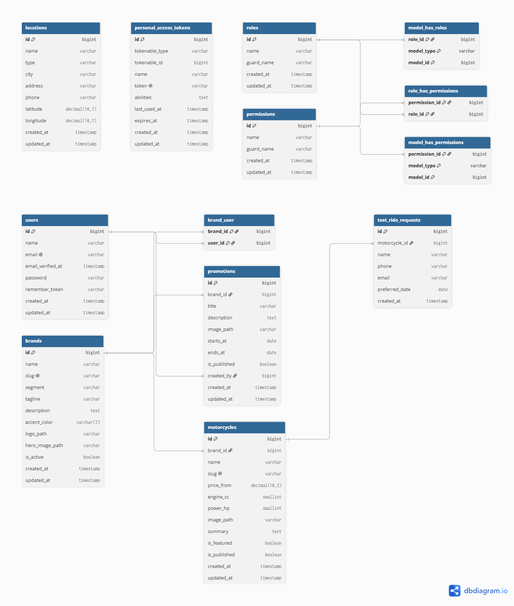

# Meridian Moto Group

> **Fictional Company Notice:** Meridian Moto Group is a fictional company created solely for recruitment assessment and demonstration purposes. All brand names, logos, trademarks, and imagery (Volt, Nomad, Apex, Sovereign) remain the property of their respective owners and are used purely for illustrative context in this engineering evaluation.

---

## Overview

Meridian Moto Group is an enterprise-grade web application and REST API platform for an exclusive high-performance motorcycle manufacturer featuring four distinct marques: **Volt** (Electric Performance), **Nomad** (Adventure & Touring), **Apex** (Track & Hyper-Sport), and **Sovereign** (Ultra-Luxury Cruisers). 

The platform consists of:
- **Backend API (`/backend`)**: Robust Laravel REST API featuring strict form request validation, service-layer business logic, repository pattern abstraction, Eloquent policies, API Resources, Sanctum authentication, Spatie permissions, and comprehensive automated test suites (Pest / PHPUnit).
- **Frontend App (`/frontend`)**: Modern Next.js (App Router, TypeScript, Tailwind CSS) web application delivering an immersive public showroom, interactive test ride booking, regional dealer hubs map (Leaflet), and a fully secured Content Management System (CMS) admin portal.

---

## Architecture

```mermaid
graph TD
    Client[Next.js Client / Browser] -->|HTTP / HTTPS| Frontend[Next.js App Router Server]
    Frontend -->|Internal API Route Handlers / Cookies| Backend[Laravel REST API /api/v1]
    Backend -->|Eloquent ORM & Policies| MySQL[(MySQL 8.4 Database)]
    Backend -->|Swagger UI / OpenAPI Spec| Docs[/docs & /docs/openapi.yaml]
    PhpMyAdmin[phpMyAdmin] -->|DB Management| MySQL
```

---

## Technology Choices & Rationale

- **Laravel & PHP 8.3/8.5**: Industry-standard robust backend framework providing elegant ORM, robust policy authorization, seamless request validation, and comprehensive testing capabilities.
- **Next.js (App Router)**: Cutting-edge React framework enabling Server-Side Rendering (SSR), server actions, high-performance static optimization, and secure cookie-based session token handling.
- **MySQL 8.4 & phpMyAdmin**: Production-ready relational database with strict constraints, indexing, and visual database management.
- **Tailwind CSS & Vanilla CSS**: High-performance utility-first styling combined with custom design tokens for rich aesthetics and responsive layouts.
- **Docker Compose**: Containerized multi-service architecture ensuring identical behavior across development and production environments.

---

## Quick Start (Production Docker Stack)

After cloning the repository, start the entire stack with a single command from the project root:

```bash
docker compose up -d --build
```

On the first run, containers will build and initialize automatically (allow 1–2 minutes for database migration and initial seed execution).

### Service Access & URLs

| Service | URL | Default Credentials / Notes |
| :--- | :--- | :--- |
| **Public Showroom** | `http://localhost:3000` | Immersive frontend catalog & test ride booking |
| **CMS Admin Login** | `http://localhost:3000/cms/login` | Secure management dashboard |
| **Laravel REST API** | `http://localhost:8000/api/v1` | JSON API endpoints |
| **Swagger UI (API Docs)** | `http://localhost:8000/docs` | Interactive API documentation |
| **phpMyAdmin** | `http://localhost:8080` | User: `meridian`, Password: `secret` |

---

## Database Design (ERD)

The database schema is engineered for performance, strict referential integrity, and multi-tenant brand scoping. Below is the Entity Relationship Diagram (ERD), defined editable in [docs/erd.dbml](docs/erd.dbml):


*Figure: Meridian Moto Group Entity Relationship Diagram.*

### Key Tables & Relationships
1. **Users & Roles (`users`, Spatie `roles`, `model_has_roles`)**: Central user entity supporting `admin` and `data_entry` roles.
2. **Brands (`brands`)**: Represents manufacturer marques (Volt, Nomad, Apex, Sovereign) with unique slugs, brand accent colors, and publication status indexes.
3. **Brand-User Scoping (`brand_user`)**: Pivot table establishing many-to-many relationship linking Data Entry users to their authorized brands, enforcing strict scoping across backend policies.
4. **Motorcycles (`motorcycles`)**: Belongs to a brand (`brand_id`), storing pricing, engine displacement (`engine_cc`), power rating (`power_hp`), and publication/feature status with composite indexes (`is_published`, `brand_id`).
5. **Promotions (`promotions`)**: Time-bound marketing campaigns tied to specific brands, tracking creator (`created_by`) and validity periods (`starts_at`, `ends_at`).
6. **Locations & Test Rides (`locations`, `test_ride_requests`)**: Dealership hubs and public test ride booking submissions linked optional to motorcycle models.

---

## Test Credentials & Authorization Matrix

The application seeds initial users across distinct roles upon startup. See [Authorization Matrix](docs/authorization-matrix.md) for detailed permission rules.

| Role | Email | Password | Access Scope |
| :--- | :--- | :--- | :--- |
| **Administrator** | `admin@meridian.test` | `Meridian @2026` | Full access across all 4 brands, models, promotions, and user management. |
| **Data Entry (Volt/Nomad)** | `entry1@meridian.test` | `Meridian @2026` | Restricted to assigned brands (Volt, Nomad) for models and promotions. |
| **Data Entry (Apex)** | `entry2@meridian.test` | `Meridian @2026` | Restricted to assigned brands (Apex) for models and promotions. |

---

## CMS Overview

The authenticated CMS portal provides administrative control over:
1. **Catalog & Models**: Manage motorcycle specifications, pricing, engine metrics, imagery, and publication status.
2. **Brands**: Configure brand marques, accents, taglines, and brand descriptions.
3. **Promotions & Campaigns**: Create and schedule promotional campaigns and seasonal offers per brand.
4. **Users Management**: Manage admin and data-entry accounts and brand assignments with self-protection guard rails.

---

## API Documentation (Swagger UI / OpenAPI)

Interactive API documentation is hosted via Swagger UI at `http://localhost:8000/docs`. 

- **Endpoints Organization**: Grouped logically by tags (`Auth`, `Catalog`, `Test Rides`, `Admin Brands`, `Admin Motorcycles`, `Admin Promotions`, `Admin Users`).
- **Try It Out**: Interactive execution of requests directly against the API with prefilled sample payloads.
- **Authentication**: Obtain a Sanctum Bearer token via `POST /auth/login`, click **Authorize**, and paste the token string.
- **Raw OpenAPI Spec**: Accessible at `http://localhost:8000/docs/openapi.yaml`.
- **Postman Collection**: Import `docs/postman/meridian-moto-api.postman_collection.json` and `docs/postman/meridian-moto-local.postman_environment.json` into Postman for immediate API testing.


*Figure: Swagger UI interactive API documentation interface.*

---

## Screenshots Gallery

### Public Showroom (Desktop)

*Figure: Immersive public showroom desktop view.*

### Public Showroom (Mobile)

*Figure: Responsive public showroom mobile view.*

---

## Security Design Summary

- **Cookie-Based Sessions**: Sanctum tokens are securely stored in HTTP-only, SameSite=Lax cookies by Next.js server route handlers, shielding tokens from XSS attacks.
- **Role-Based Access Control (RBAC)**: Backend Eloquent policies and Spatie permission middleware enforce strict resource ownership and role checks.
- **Data Validation**: Comprehensive Zod schemas on the frontend and strict Form Request validation rules on the backend prevent malformed input.

---

## AI-Generated Assets and Content

In accordance with project guidelines and assessment requirements, the visual design concepts, motorcycle photography, and promotional sample text content were generated using **Google Stitch / generative tools** specifically for this fictional company demonstration. None of the generated assets depict real-world brand trademarks. Detailed image attributions are located in `frontend/public/images/ATTRIBUTION.md`.

---

## Links & Deliverables

- **Design Link**: [Insert Design System / Figma Link Here]
- **Demo Video Link**: [Insert Loom / Video Demonstration Link Here]

---

## Assumptions & Trade-offs

- **Local Storage / Public Disk**: Uploaded images are stored in Laravel's public disk storage mapped via Docker volumes for persistence across container restarts.
- **Authentication Flow**: Next.js App Router API route handlers proxy requests to Laravel backend while managing secure cookie sessions.

---

## What I Would Do Next

- Implement automated end-to-end testing (Playwright) for critical user journeys (test ride booking and CMS workflows).
- Add Redis-backed caching for high-traffic public catalog endpoints.
- Integrate real-time notification websockets for test ride requests.

---

## Attribution & References

- **Typography**: Inter & Barlow Condensed (Google Fonts).
- **Icons**: Lucide React.
- **Maps**: Leaflet & React-Leaflet with OpenStreetMap tiles.
- **API Documentation**: Swagger UI (OpenAPI 3.0 specification).
- **Core Frameworks**: Laravel, Next.js, Tailwind CSS, Pest, Vitest.
